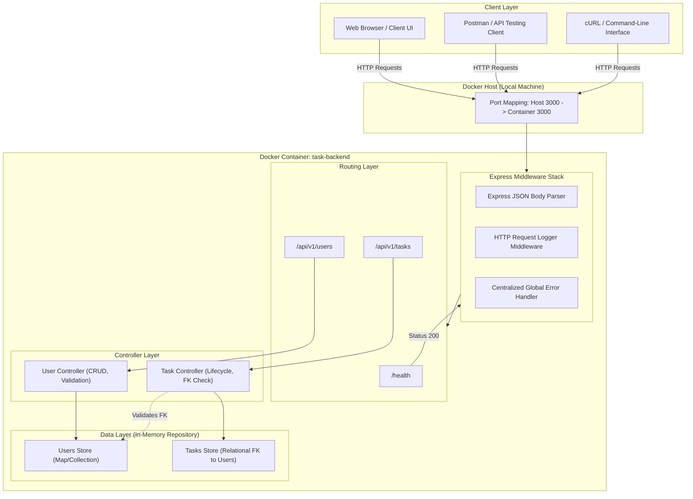

# API Contract & System Architecture
## Coursework Activity - Chapter 3

---

## 1. Project Resources

The system identifies two primary domain resources:
1. **Users (`User`)**: Represents system members who create or are assigned tasks.
2. **Tasks (`Task`)**: Represents actionable work items assigned to users with lifecycle states.

### Data Schemas

#### User Schema
| Field | Type | Description | Example |
|---|---|---|---|
| `id` | `string` | Unique identifier (UUID) | `"usr-101"` |
| `name` | `string` | Full name of the user | `"Arash Rasouli"` |
| `email` | `string` | Unique email address | `"arash@example.com"` |
| `role` | `string` | Role (`admin`, `member`) | `"member"` |
| `createdAt` | `string (ISO 8601)` | Timestamp of creation | `"2026-11-18T20:00:00.000Z"` |

#### Task Schema
| Field | Type | Description | Example |
|---|---|---|---|
| `id` | `string` | Unique task identifier (UUID) | `"tsk-201"` |
| `title` | `string` | Brief title of the task | `"Design Dockerfile"` |
| `description` | `string` | Detailed description | `"Containerize backend with port mapping"` |
| `status` | `string` | Enum: `TODO`, `IN_PROGRESS`, `DONE` | `"IN_PROGRESS"` |
| `priority` | `string` | Enum: `LOW`, `MEDIUM`, `HIGH` | `"HIGH"` |
| `assignedUserId` | `string` | ID of assigned User | `"usr-101"` |
| `dueDate` | `string (ISO 8601)` | Deadline date | `"2026-11-25T23:59:59.000Z"` |
| `createdAt` | `string (ISO 8601)` | Timestamp of creation | `"2026-11-18T20:00:00.000Z"` |
| `updatedAt` | `string (ISO 8601)` | Last update timestamp | `"2026-11-18T20:30:00.000Z"` |

---

## 2. API Endpoints Specification

Base URL: `http://localhost:3000/api/v1`

| Resource | HTTP Method | Endpoint | Description | Success Status | Error Statuses |
|---|---|---|---|---|---|
| **System** | `GET` | `/health` | Service health status check | `200 OK` | `500 Internal Server Error` |
| **Users** | `GET` | `/api/v1/users` | Retrieve list of all users | `200 OK` | `500 Internal Server Error` |
| **Users** | `GET` | `/api/v1/users/:id` | Retrieve single user by ID | `200 OK` | `404 Not Found`, `400 Bad Request` |
| **Users** | `POST` | `/api/v1/users` | Register a new user | `201 Created` | `400 Bad Request`, `409 Conflict` |
| **Users** | `PUT` | `/api/v1/users/:id` | Update an existing user | `200 OK` | `400 Bad Request`, `404 Not Found` |
| **Users** | `DELETE` | `/api/v1/users/:id` | Delete user and unassign their tasks | `204 No Content` | `404 Not Found` |
| **Tasks** | `GET` | `/api/v1/tasks` | List tasks (supports `?status=&priority=&userId=`) | `200 OK` | `500 Internal Server Error` |
| **Tasks** | `GET` | `/api/v1/tasks/:id` | Retrieve single task by ID | `200 OK` | `404 Not Found` |
| **Tasks** | `POST` | `/api/v1/tasks` | Create a new task | `201 Created` | `400 Bad Request`, `404 Not Found` (invalid assignedUserId) |
| **Tasks** | `PUT` | `/api/v1/tasks/:id` | Fully update a task | `200 OK` | `400 Bad Request`, `404 Not Found` |
| **Tasks** | `PATCH` | `/api/v1/tasks/:id/status` | Partially update task state (`TODO`/`IN_PROGRESS`/`DONE`) | `200 OK` | `400 Bad Request`, `404 Not Found` |
| **Tasks** | `DELETE` | `/api/v1/tasks/:id` | Delete a task | `204 No Content` | `404 Not Found` |

---

## 3. Request & Response Payload Examples

### `POST /api/v1/users`
**Request Body:**
```json
{
  "name": "Sarah Connor",
  "email": "sarah@example.com",
  "role": "admin"
}
```
**Response (201 Created):**
```json
{
  "success": true,
  "data": {
    "id": "usr-1731960000000",
    "name": "Sarah Connor",
    "email": "sarah@example.com",
    "role": "admin",
    "createdAt": "2026-11-18T20:15:00.000Z"
  }
}
```

### `POST /api/v1/tasks`
**Request Body:**
```json
{
  "title": "Set up CI/CD pipeline",
  "description": "Configure automated testing and container build workflow",
  "status": "TODO",
  "priority": "HIGH",
  "assignedUserId": "usr-101",
  "dueDate": "2026-11-30T00:00:00.000Z"
}
```
**Response (201 Created):**
```json
{
  "success": true,
  "data": {
    "id": "tsk-1731960000000",
    "title": "Set up CI/CD pipeline",
    "description": "Configure automated testing and container build workflow",
    "status": "TODO",
    "priority": "HIGH",
    "assignedUserId": "usr-101",
    "dueDate": "2026-11-30T00:00:00.000Z",
    "createdAt": "2026-11-18T20:15:00.000Z",
    "updatedAt": "2026-11-18T20:15:00.000Z"
  }
}
```

---

## 4. System Architecture Diagram


