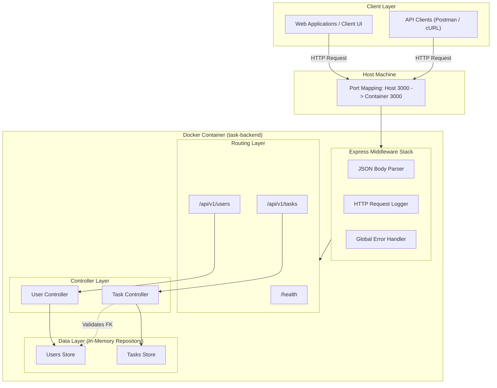

# Task Management Backend Service

> **Repository:** `a-rasouly/uni`  
> **Tech Stack:** Node.js, Express, Docker, REST API

A modular, production-ready RESTful backend service for managing tasks and user assignments. Designed with clean architecture, containerized with Docker, covered by automated integration tests, and documented with a formal API contract.

---

## Table of Contents

- [Features](#features)
- [System Architecture](#system-architecture)
- [API Specification](#api-specification)
- [Docker & Containerization](#docker--containerization)
- [Git Workflow & Branching](#git-workflow--branching)
- [Local Development & Testing](#local-development--testing)

---

## Features

- **User Management:** Full CRUD operations for system users with role and unique email validation.
- **Task Management:** Lifecycle tracking (`TODO`, `IN_PROGRESS`, `DONE`), priority levels (`LOW`, `MEDIUM`, `HIGH`), due dates, and user assignments with foreign key integrity.
- **RESTful Contract:** Predictable endpoints following HTTP semantics and standard status codes.
- **Containerized Deployment:** Alpine-based Docker image with non-root security execution and automated health monitoring.
- **Automated Test Suite:** Built-in integration tests with 100% route and status code coverage.

---

## System Architecture

The service utilizes a layered architecture within a containerized environment:



---

## API Specification

Base URL: `http://localhost:3000/api/v1`

### Endpoints Overview

| # | Resource | Method | Endpoint | Description | Success Status | Error Statuses |
|---|---|---|---|---|---|---|
| 1 | **System** | `GET` | `/health` | Service health status check | `200 OK` | `500 Internal Error` |
| 2 | **Users** | `GET` | `/api/v1/users` | List all users | `200 OK` | `500 Internal Error` |
| 3 | **Users** | `GET` | `/api/v1/users/:id` | Get single user by ID | `200 OK` | `404 Not Found`, `400 Bad Request` |
| 4 | **Users** | `POST` | `/api/v1/users` | Register a new user | `201 Created` | `400 Bad Request`, `409 Conflict` |
| 5 | **Users** | `PUT` | `/api/v1/users/:id` | Update existing user details | `200 OK` | `400 Bad Request`, `404 Not Found` |
| 6 | **Users** | `DELETE` | `/api/v1/users/:id` | Remove user & unassign tasks | `204 No Content` | `404 Not Found` |
| 7 | **Tasks** | `GET` | `/api/v1/tasks` | List tasks (supports query filters) | `200 OK` | `500 Internal Error` |
| 8 | **Tasks** | `GET` | `/api/v1/tasks/:id` | Get single task by ID | `200 OK` | `404 Not Found` |
| 9 | **Tasks** | `POST` | `/api/v1/tasks` | Create a new task | `201 Created` | `400 Bad Request`, `404 Not Found` |
| 10 | **Tasks** | `PUT` | `/api/v1/tasks/:id` | Full update of task | `200 OK` | `400 Bad Request`, `404 Not Found` |
| 11 | **Tasks** | `PATCH` | `/api/v1/tasks/:id/status` | Update task status | `200 OK` | `400 Bad Request`, `404 Not Found` |
| 12 | **Tasks** | `DELETE` | `/api/v1/tasks/:id` | Delete task | `204 No Content` | `404 Not Found` |

> Detailed schemas, parameters, and sample request/response JSON payloads are available in [`API_CONTRACT.md`](./API_CONTRACT.md).

---

## Docker & Containerization

### Docker Configuration
- **Base Image:** `node:20-alpine` (minimal attack surface, small footprint).
- **Security:** Runs under unprivileged user `node`.
- **Healthcheck:** Automatic container health monitoring via `wget` spider on `/health`.
- **Port Mapping:** Exposes port `3000` mapped to host port `3000`.

### Container Commands

```bash
# 1. Build Docker image
docker build -t task-backend:latest .

# 2. Run container with port mapping
docker run -d -p 3000:3000 --name task-app task-backend:latest

# 3. Check container status
docker ps

# 4. View application logs
docker logs task-app

# 5. Verify API endpoints via curl
curl http://localhost:3000/health
curl http://localhost:3000/api/v1/users
curl http://localhost:3000/api/v1/tasks

# 6. Stop and remove container
docker stop task-app
docker rm task-app
```

### Docker Compose
For unified local execution, run:
```bash
docker compose up -d
```

---

## Git Workflow & Branching

The project follows standard Git Flow conventions:
- **`main`**: Production-ready, stable codebase.
- **`feature/task-management-api`**: Dedicated feature branch containing modular, atomic commits.
- **Commit Conventions:** Follows the [Conventional Commits](https://www.conventionalcommits.org/) specification (`feat:`, `docs:`, `ci:`, `chore:`).

---

## Local Development & Testing

### Prerequisites
- Node.js >= 20.0.0
- npm >= 10.0.0

### Setup

```bash
# Install dependencies
npm install

# Run automated test suite (14 passing tests)
npm test

# Run application in development mode with live watch
npm run dev

# Run application in production mode
npm start
```
