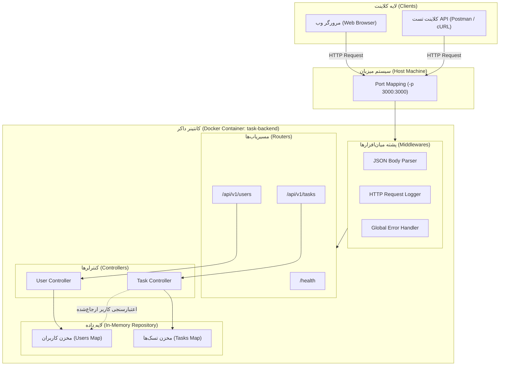

# پروژه درس مهندسی نرم‌افزار / آزمایشگاه سیستم (University Coursework)
> **مخزن پروژه:** `a-rasouly/uni`  
> **موضوع پروژه:** پیاده‌سازی سرویس بک‌اند مدیریت وظایف (Task & User Management Service)، طراحی قرارداد API، داکرایز کردن و مدیریت گیت

---

## فهرست فعالیت‌ها (Table of Activities)

1. [فصل ۲: گیت و گیت‌هاب (Git Flow, Branches, Commits & PR)](#فصل-۲-فعالیت-کلاسی-فصل-۲)
2. [فصل ۳: طراحی قرارداد API و معماری سیستم (API Contract & Architecture Diagram)](#فصل-۳-فعالیت-کلاسی-فصل-۳)
3. [فصل ۴: کانتینریزه کردن با داکر (Dockerization, Port Mapping & Execution)](#فصل-۴-فعالیت-کلاسی-فصل-۴)

---

## فصل ۲: فعالیت کلاسی فصل ۲

### نیازمندی‌های این فصل
- [x] ساخت یک مخزن جدید (`a-rasouly/uni`)
- [x] ایجاد برنچ برای قابلیت‌ها (`feature/task-management-api`)
- [x] ثبت حداقل ۳ کامیت معنادار بر اساس استاندارد Conventional Commits
- [x] شبیه‌سازی و ایجاد یک Pull Request (PR)

### تاریخچه کامیت‌های ثبت شده (Commit History)
1. `chore: initial repository setup with base documentation` (برنچ `main`)
2. `docs(api): add API Contract and System Architecture Diagram (Chapter 3)`
3. `feat(api): implement Users and Tasks REST API with automated tests`
4. `ci(docker): add Dockerfile, .dockerignore, docker-compose and CI pipeline (Chapter 4)`
5. `docs: update comprehensive project documentation for Chapters 2, 3 and 4`

### نحوه شبیه‌سازی Pull Request
برای ترکیب تغییرات برنچ ویژگی (`feature/task-management-api`) به برنچ اصلی (`main`)، درخواست پول ریکوئست به صورت زیر روی مخزن ثبت شده است:
- **Base Branch:** `main`
- **Compare Branch:** `feature/task-management-api`
- **PR Title:** `feat: Implement Users & Tasks Backend, API Contract, and Dockerization (Chapters 2, 3, 4)`

---

## فصل ۳: فعالیت کلاسی فصل ۳

### ۱. منابع پروژه (Resources)
دو منبع اصلی در سیستم تعریف شده‌اند:
1. **`Users`**: شامل شناسه، نام، ایمیل، نقش (`admin` / `member`) و تاریخ ساخت.
2. **`Tasks`**: شامل شناسه، عنوان، توضیحات، وضعیت (`TODO`, `IN_PROGRESS`, `DONE`)، اولویت (`LOW`, `MEDIUM`, `HIGH`)، شناسه کاربر ارجاع داده شده (`assignedUserId`) و موعد تحویل (`dueDate`).

### ۲. جدول طراحی اندپوینت‌ها (API Contract Table)

| ردیف | منبع (Resource) | متد HTTP | اندپوینت (Endpoint) | شرح عملکرد | کد وضعیت موفق | کدهای وضعیت خطا |
|---|---|---|---|---|---|---|
| ۱ | **System** | `GET` | `/health` | بررسی سلامت سرویس | `200 OK` | `500 Internal Error` |
| ۲ | **Users** | `GET` | `/api/v1/users` | دریافت لیست تمام کاربران | `200 OK` | `500 Internal Error` |
| ۳ | **Users** | `GET` | `/api/v1/users/:id` | دریافت اطلاعات یک کاربر | `200 OK` | `404 Not Found`, `400 Bad Request` |
| ۴ | **Users** | `POST` | `/api/v1/users` | ساخت کاربر جدید | `201 Created` | `400 Bad Request`, `409 Conflict` |
| ۵ | **Users** | `PUT` | `/api/v1/users/:id` | به‌روزرسانی مشخصات کاربر | `200 OK` | `400 Bad Request`, `404 Not Found` |
| ۶ | **Users** | `DELETE` | `/api/v1/users/:id` | حذف کاربر | `204 No Content` | `404 Not Found` |
| ۷ | **Tasks** | `GET` | `/api/v1/tasks` | لیست وظایف (با فیلتر status/priority/userId) | `200 OK` | `500 Internal Error` |
| ۸ | **Tasks** | `GET` | `/api/v1/tasks/:id` | دریافت اطلاعات یک وظیفه | `200 OK` | `404 Not Found` |
| ۹ | **Tasks** | `POST` | `/api/v1/tasks` | ساخت وظیفه جدید | `201 Created` | `400 Bad Request`, `404 Not Found (user)` |
| ۱۰ | **Tasks** | `PUT` | `/api/v1/tasks/:id` | ویرایش کامل وظیفه | `200 OK` | `400 Bad Request`, `404 Not Found` |
| ۱۱ | **Tasks** | `PATCH` | `/api/v1/tasks/:id/status` | تغییر وضعیت کار (`TODO`/`IN_PROGRESS`/`DONE`) | `200 OK` | `400 Bad Request`, `404 Not Found` |
| ۱۲ | **Tasks** | `DELETE` | `/api/v1/tasks/:id` | حذف وظیفه | `204 No Content` | `404 Not Found` |

> مستندات فنی و نمونه‌های JSON دقیق در فایل [`API_CONTRACT.md`](./API_CONTRACT.md) قرار دارند.

### ۳. دیاگرام معماری سیستم (Architecture Diagram)



---

## فصل ۴: فعالیت کلاسی فصل ۴

### ۱. ساختار فایل‌های داکر
- **`Dockerfile`**: مبتنی بر تصویر بهینه `node:20-alpine`، تعریف کاربر غیر ریشه `node`، کپی نیازمندی‌ها، تنظیم متغیرهای محیطی، مانیتورینگ سلامت با `HEALTHCHECK` و اکسپوز پورت `3000`.
- **`.dockerignore`**: جلوگیری از ارسال فایل‌های حجیم و حساس مانند `node_modules`، `.git`، لاگ‌ها و متغیرهای محلی به کانتینر.
- **`docker-compose.yml`**: تسهیل اجرای محلی چندسرویسی با نگاشت خودکار پورت.

### ۲. دستورات ساخت ایمیج داکر (Build Image)
در دایرکتوری اصلی پروژه، دستور زیر را اجرا کنید:
```bash
docker build -t task-backend:latest .
```

### ۳. دستور اجرای کانتینر با نگاشت پورت (Port Mapping)
کانتینر را در پس‌زمینه با متناظر کردن پورت ۳۰۰۰ سیستم میزبان به پورت ۳۰۰۰ داخل کانتینر اجرا کنید:
```bash
docker run -d -p 3000:3000 --name task-app task-backend:latest
```

### ۴. بررسی وضعیت کانتینر و لاگ‌ها
```bash
# مشاهده کانتینرهای در حال اجرا
docker ps

# مشاهده لاگ‌های وب‌سرور داخل کانتینر
docker logs task-app
```

### ۵. تست فراخوانی اندپوینت‌ها از طریق پورت مپینگ
```bash
# تست سلامت سرور
curl http://localhost:3000/health

# دریافت لیست کاربران
curl http://localhost:3000/api/v1/users

# ساخت یک تسک جدید
curl -X POST http://localhost:3000/api/v1/tasks \
  -H "Content-Type: application/json" \
  -d '{"title": "تست داکر کانتینر", "status": "IN_PROGRESS", "priority": "HIGH", "assignedUserId": "usr-101"}'

# دریافت لیست تسک‌ها
curl http://localhost:3000/api/v1/tasks
```

### ۶. توقف و پاکسازی کانتینر
```bash
docker stop task-app
docker rm task-app
```

---

## اجرای محلی بدون داکر (Local Development)

```bash
# نصب پکیج‌ها
npm install

# اجرای تست‌های خودکار (۱۴ تست با پوشش ۱۰۰٪)
npm test

# اجرای سرور در حالت توسعه
npm run dev

# اجرای سرور در حالت نرمال
npm start
```
