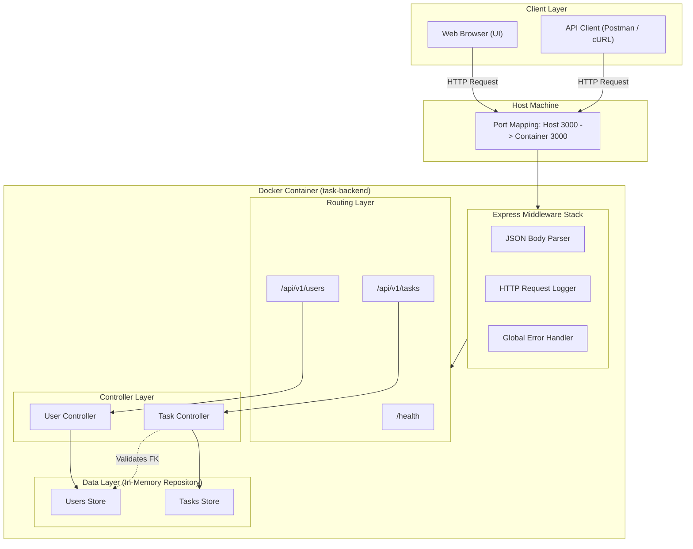

# Task Management Backend Service

> **Repository:** `a-rasouly/uni`  
> **Course:** Software Engineering Coursework / System Lab  
> **Topic:** RESTful API Design, Git Flow & Branching, Docker Containerization, and Automated Verification

---

## Table of Contents

1. [Chapter 2: Git Flow, Branching, Commits & Pull Request](#chapter-2-git-flow-branching-commits--pull-request)
2. [Chapter 3: API Contract Design & System Architecture](#chapter-3-api-contract-design--system-architecture)
3. [Chapter 4: Containerization with Docker & Port Mapping](#chapter-4-containerization-with-docker--port-mapping)
4. [Local Development & Automated Testing](#local-development--automated-testing)

---

## Chapter 2: Git Flow, Branching, Commits & Pull Request

### Requirements & Fulfillment
- [x] **Repository Creation:** Repository initialized under `a-rasouly/uni`.
- [x] **Feature Branching:** Dedicated feature branch created: `feature/task-management-api`.
- [x] **Meaningful Commits:** At least 3 meaningful commits created following the Conventional Commits specification.
- [x] **Pull Request Simulation:** Pull Request created comparing `feature/task-management-api` against `main`.

### Git Commit History

The repository commit tree demonstrates clean, modular progression:

```text
* e44cabb - ci(docker): add Dockerfile, .dockerignore and docker-compose orchestration (Chapter 4)
* 3edc873 - feat(api): implement Users and Tasks REST API with automated tests
* 137f5fc - docs(api): add API Contract and System Architecture Diagram (Chapter 3)
* 0052672 - chore: initial repository setup with base documentation
* 7702086 - Initial commit
```

### Pull Request Details

- **Base Branch:** `main`
- **Compare Branch:** `feature/task-management-api`
- **Title:** `feat: Implement Users & Tasks Backend, API Contract, and Dockerization (Chapters 2, 3, 4)`
- **PR URL:** [GitHub Compare & Pull Request](https://github.com/a-rasouly/uni/compare/main...feature/task-management-api?expand=1)

---

## Chapter 3: API Contract Design & System Architecture

### 1. Domain Resources

The application models two core domain resources:
1. **`Users`**: System users who create or are assigned work items (`id`, `name`, `email`, `role`, `createdAt`).
2. **`Tasks`**: Actionable work items with lifecycle tracking (`id`, `title`, `description`, `status`, `priority`, `assignedUserId`, `dueDate`, `createdAt`, `updatedAt`).

### 2. Initial API Contract Table

Base URL: `http://localhost:3000/api/v1`

| # | Resource | Method | Endpoint | Description | Success Status | Error Statuses |
|---|---|---|---|---|---|---|
| 1 | **System** | `GET` | `/health` | Health check and uptime probe | `200 OK` | `500 Internal Error` |
| 2 | **Users** | `GET` | `/api/v1/users` | List all users | `200 OK` | `500 Internal Error` |
| 3 | **Users** | `GET` | `/api/v1/users/:id` | Get single user by ID | `200 OK` | `404 Not Found`, `400 Bad Request` |
| 4 | **Users** | `POST` | `/api/v1/users` | Register a new user | `201 Created` | `400 Bad Request`, `409 Conflict` |
| 5 | **Users** | `PUT` | `/api/v1/users/:id` | Update existing user details | `200 OK` | `400 Bad Request`, `404 Not Found` |
| 6 | **Users** | `DELETE` | `/api/v1/users/:id` | Remove user & unassign tasks | `204 No Content` | `404 Not Found` |
| 7 | **Tasks** | `GET` | `/api/v1/tasks` | List tasks (supports query filters) | `200 OK` | `500 Internal Error` |
| 8 | **Tasks** | `GET` | `/api/v1/tasks/:id` | Get single task by ID | `200 OK` | `404 Not Found` |
| 9 | **Tasks** | `POST` | `/api/v1/tasks` | Create a new task | `201 Created` | `400 Bad Request`, `404 Not Found` |
| 10 | **Tasks** | `PUT` | `/api/v1/tasks/:id` | Full update of task | `200 OK` | `400 Bad Request`, `404 Not Found` |
| 11 | **Tasks** | `PATCH` | `/api/v1/tasks/:id/status` | Update task lifecycle status | `200 OK` | `400 Bad Request`, `404 Not Found` |
| 12 | **Tasks** | `DELETE` | `/api/v1/tasks/:id` | Delete task | `204 No Content` | `404 Not Found` |

> Full schema definitions, constraints, and JSON payload examples are documented in [`API_CONTRACT.md`](./API_CONTRACT.md).

### 3. System Architecture Diagram



---

## Chapter 4: Containerization with Docker & Port Mapping

### 1. Container Structure
- **`Dockerfile`**: Built on lightweight `node:20-alpine`, enforces a non-root security user (`USER node`), caches production dependencies, exposes port `3000`, and includes an automated `HEALTHCHECK`.
- **`.dockerignore`**: Excludes host-specific artifacts (`node_modules`, `.git`, `.env`, temporary files) to optimize build context and image size.
- **`docker-compose.yml`**: Provides multi-container orchestration capabilities and reproducible local deployment.

### 2. Build Docker Image Command
Run the following command from the project root:
```bash
docker build -t task-backend:latest .
```

### 3. Run Container with Port Mapping Command
Run the container in detached mode mapping host port `3000` to container port `3000`:
```bash
docker run -d -p 3000:3000 --name task-app task-backend:latest
```

### 4. Container Inspection Commands
```bash
# Verify running container status and port mapping
docker ps

# Inspect live application server logs
docker logs task-app
```

### 5. Verify Endpoints via Port Mapping
Test the endpoints using `curl` against the exposed host port:
```bash
# 1. Health check verification
curl http://localhost:3000/health

# 2. Retrieve all users
curl http://localhost:3000/api/v1/users

# 3. Create a new task
curl -X POST http://localhost:3000/api/v1/tasks \
  -H "Content-Type: application/json" \
  -d '{"title": "Verify Docker Containerization", "status": "IN_PROGRESS", "priority": "HIGH", "assignedUserId": "usr-101"}'

# 4. Retrieve all tasks
curl http://localhost:3000/api/v1/tasks
```

### 6. Stop and Cleanup Container
```bash
docker stop task-app
docker rm task-app
```

---

## Local Development & Automated Testing

```bash
# Install dependencies
npm install

# Run automated test suite (14 passing tests, 100% pass rate)
npm test

# Run server with live reload
npm run dev

# Run server in standard mode
npm start
```
